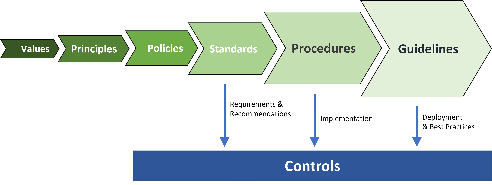

# Principles, Policies, Standards, Guidelines, and Procedures

Principles, Policies, and Standards… These are terms sometimes used interchangeably albeit sometimes incorrectly. At a basic level, a policy and a standard both communicate “something you have to do”. But there is taxonomy that should be employed for an effective policy framework.

Corporate values drive principles, which in turn drive policies. Standards contain the specific rules (MUST DOs) and emphasized recommendations (SHOULD DOs). Guidelines and procedures are based on the associated standards and provide context as to how to implement a given standard. The figure below illustrates the policy framework drive train, starting with just a few corporate values and expanding into numerous procedures.

## Terminology
In all the policy framework documents I write, I like to include an abbreviated set of the definitions as part of the introductory boilerplate text to help alleviate any confusion.

* ***Values*** are prescribed and adopted by the company board of directors and form the foundation by which the company works. Four to seven values are normally adopted. For example “Customer Obsession”, “Care”, “Agility”, etc. These are often brief and punchy for maximum impact. Take a look at Centrica’s corporate values. Values are usually accompanied by a mission statement to clearly articulate the company’s priority and focus.
* ***Principles*** are statements of thought or belief which form the fundamental basis about attitudes and the way to behave. These may be company-wide or may be business unit or function-specific. Take a look at Amazon’s Leadership Principles and at Microsoft’s Ten Design Principles for Azure Applications.
* ***Tenets*** are principles or beliefs that provide decision-making / trade-off guidance in order to deliver the best value to customers. They are signposts that suggest not that way, this way. An example might be “We prioritize ease of use over performance”. A good tenet is a tie-breaker or directive that influences actions and decisions through alignment with corporate, team, or project level values.
* ***Policies*** are formal, brief, high-level statements that typically includes declarations to require compliance with associated standards and regulatory requirements with a focus on the desired results and not the means of implementation. A policy statement might be “We will vigilantly protect customer data”. In most cases, policies and principles are published together. Take a look at IBM’s Corporate Policies and Principles.
* ***Standards*** contain the mandatory, recommended, and optional actions and rules to generally support and conform to a given policy. Each standards document is typically subject specific (e.g., “Identity and Access Management Standard”). Mandatory statements should be specific and measurable. Take a look at the PCI Security Standards which are accompanied by the associated goal. Audits take place against published standards.
* ***Procedures*** describe respective processes: who does what, when they do it, and under what criteria. A procedure may contain multiple ways to achieve the associated objective and may or may not be mandatory, depending on what is stated in the related standards document.
* ***Guidelines*** provide the general statements, recommendations, and administrative instructions designed to achieve policy objectives and conform to standards by providing a framework within which to implement procedures. Guidelines are not generally prescriptive and often provide best practices for the company.
* ***Controls*** are specific safeguards or countermeasures to avoid, detect, counteract, or minimize security risks to physical assets, information, computer systems, or other resources, typically designed to protect the confidentiality, integrity and availability of information. Controls specify the mechanisms to implement the requirements and recommendations set forth in Standards. A single control (such as deploying a firewall at every ingress point) often satisfies multiple security requirements. In open standards such ISO/IEC 27002, controls may take the form of recommendations (e.g., “Security perimeters should be used to protect areas that contain information and information processing facilities.”).

## What makes a good standard?
Each rule or recommendation statement with a standard should use capitalized terms from IETF RFC-2119 to indicate whether a statement is mandatory, recommended, or optional (e.g., “MUST”, “MUST NOT”, “REQUIRED”, “SHALL”, “SHALL NOT”, “SHOULD”, “SHOULD NOT”, “RECOMMENDED”, “MAY”, and “OPTIONAL”).

A good standard will have clear, concise, specific, measurable, attainable statements — much like SMART objectives. Consider the statement: “Passwords MUST be long and complex.” While such a requirement may sound reasonable, it is subject to broad interpretation due to the lack of specificity. You might consider 8 characters as the minimum minimum with one upper case, lower case, and a digit. Along comes the auditor… who’s view of “long” is 10 characters and “complex” includes a symbol. You could easily fail the audit point because the statement is not readily measurable.

A better statement would be “Standard user passwords MUST be at least 8 characters long, and contain at least one upper case character, one lower case character, and one digit.” While slightly longer, there is little room for confusion by being more specific about the size and scope (being “standard users”, which presumably you will define within the document).

I like to include “SHOULD” do statements within standards. Some might argue that if it is not a requirement, then it does not belong in the standard. My counter argument is that the “SHOULD” statements are included to strongly recommend a particular course of action and to drive best practice. But it also may be a point which you’re not fully prepared to be audited on. The current SHOULD do statements may eventually evolve into MUST do requirements (after all those legacy systems are brought into compliance of course).

## Don’t get carried away!
Statements within each standard should focus on those requirements which reduce risk for the firm and/or are needed for regulatory or compliance reasons, or are needed to enforce policy. It’s easy to get carried away and turn every corporate practice into a rule. Just remember… if it’s stated as a “MUST” do in the standard, then you can get audited against it!

Think about what is really important. For example, requiring multi-factor authentication for all privileged account access. If there is a particular practice that you want followed (but don’t want to be audited by), publish it in the guidelines and procedures.

If your aim is compliance with a published standard such as ISO/IEC 27001, then make sure that the required actions align with the required actions of the published standard (i.e., a “MUST” in the published standard must also be a MUST in your standard — otherwise, you may fail the associated compliance audit).

## Exceptions…
In some cases, it is necessary for corporate requirements to be merged into a single “policy” document as a blend of policy statements and standard requirements. A corporate “Acceptable Use Policy” is a great example. It is usually written in a friendly prose style stating what you can and cannot do.

## Organizing it all…
You might choose to capture statements in a spreadsheet, or simply publish the statements as bullet or numbered points in the various standards documents. There are some 3rd party tools to help but may require more effort up front. You may choose to publish guidelines and procedures using a collaboration tool, so that improvements and updates to process can be readily made. Principles, policies, and standards, on the other hand, are subject to more rigorous review and approval, and so may be published accordingly.

The Standard of Good Practice for Information Security, published by the Information Security Forum (ISF) provides good guidance about the things to consider when writing information security standards.

## Additional Reading…
ComplianceForge has put together a more detailed description of these and related terms which I highly recommend: https://complianceforge.com/grc/policy-vs-standard-vs-control-vs-procedure

Also see thier PDF: https://complianceforge.com/content/pdf/complianceforge-hierarchical-cybersecurity-governance-framework.pdf